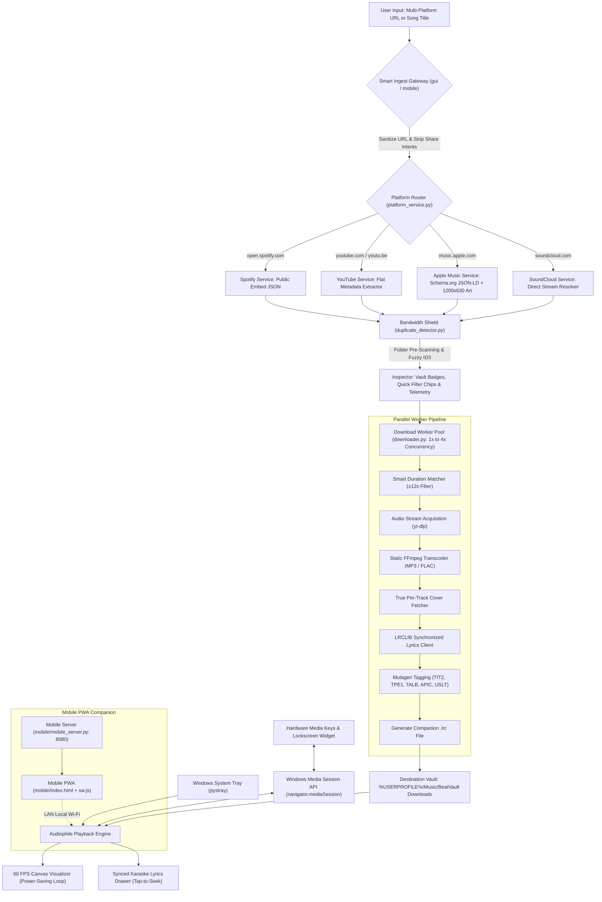

<div align="center">


```
██████╗ ███████╗ █████╗ ████████╗██╗   ██╗ █████╗ ██╗   ██╗██╗  ████████╗
██╔══██╗██╔════╝██╔══██╗╚══██╔══╝██║   ██║██╔══██╗██║   ██║██║  ╚══██╔══╝
██████╔╝█████╗  ███████║   ██║   ██║   ██║███████║██║   ██║██║     ██║   
██╔══██╗██╔══╝  ██╔══██║   ██║   ╚██╗ ██╔╝██╔══██║██║   ██║██║     ██║   
██████╔╝███████╗██║  ██║   ██║    ╚████╔╝ ██║  ██║╚██████╔╝███████╗██║   
╚═════╝ ╚══════╝╚═╝  ╚═╝   ╚═╝     ╚═══╝  ╚═╝  ╚═╝ ╚═════╝ ╚══════╝╚═╝   
```

# 🎵 BEATVAULT
### *Studio-Grade Music Archival, Synced Lyrics Workstation & Multi-Platform Engine*

<p align="center">
  <b>Featuring the Obsidian Sonic Desktop Workstation & Mobile PWA Companion • Powered by Python 3.11+ & Fluent Dark WebView2</b>
</p>

<p align="center">
  <a href="https://github.com/aadityashekhar321/BeatVault/releases/latest">
    
  </a>
  <a href="https://github.com/aadityashekhar321/BeatVault/releases/latest">
    
  </a>
  <a href="https://github.com/aadityashekhar321/BeatVault/releases/latest">
    
  </a>
  <a href="https://github.com/aadityashekhar321/BeatVault/stargazers">
    
  </a>
</p>

<p align="center">
  
  
  
  
  
  
  
  
  
  
  
  
</p>

<p align="center">
  <code>🎛️ Obsidian Sonic Desktop Workstation</code> •
  <code>📱 Mobile PWA Companion App</code> •
  <code>⚡ 1x–4x Configurable Concurrency</code> •
  <code>🎤 Synced Karaoke Lyrics (.LRC + ID3)</code> •
  <code>🌊 60 FPS Power-Saving Canvas Visualizer</code> •
  <code>🛡️ 160/160 Automated Tests Passing</code>
</p>

<br/>

**BeatVault** is an elite, studio-grade desktop audio workstation and preservation engine built for audiophiles, DJs, and music collectors. It seamlessly imports albums, playlists, and individual tracks across **Spotify, YouTube / YouTube Music, Apple Music, and SoundCloud**, transcoding them into metadata-complete, high-fidelity MP3/FLAC audio files. Engineered with the **Obsidian Sonic Studio Workstation**, a **touch-ready Mobile PWA companion app**, **configurable 1x to 4x parallel stream downloading**, **Apple Music-style synchronized karaoke lyrics (`.lrc` sidecar files & ID3 tags)**, **real-time 60 FPS HTML5 canvas audio spectrum visualizer with background power-saving auto-pause**, **acoustic duration matching**, **non-destructive duplicate protection with background pre-scanning**, **Windows Media Session API hardware media keys integration**, and **system notification tray background execution**.

<br/>

[⚡ Quick Start](#-quick-start--installation) • [✨ Core Capabilities](#-core-capabilities--feature-showcase) • [📱 Mobile PWA Companion](#-mobile-pwa-companion-app) • [⌨️ Keyboard Shortcuts](#️-keyboard-shortcuts) • [📊 Comparison](#-comparison-matrix) • [🏗️ Architecture](#️-system-architecture) • [🛡️ Quality Shield](#-automated-testing--quality-shield) • [⚙️ Settings](#️-settings--persistence) • [❓ FAQ](#-faq)

</div>

---

## ⚡ Quick Start & Installation

### 🎯 Option A: Official Windows Setup Wizard • *Recommended for All Users*
> **Zero configuration required.** Bundles all dependencies and static FFmpeg binaries. No external runtimes or Python installation needed.

1. Download **[`BeatVault-Setup.exe`](https://github.com/aadityashekhar321/BeatVault/releases/latest)** from the latest GitHub Release.
2. Run the modern setup wizard:
   - 📁 Installs directly to `%LocalAppData%\Programs\BeatVault` (no administrative privileges required).
   - 🖥️ Automatically creates a **Desktop Shortcut** with high-resolution app branding.
   - 🪟 Registers cleanly in the **Windows Start Menu**.
   - 🧼 Includes a full Windows uninstaller in Control Panel / Apps & Features.

---

### 📦 Option B: Portable Standalone Executable
1. Download **[`BeatVault.exe`](https://github.com/aadityashekhar321/BeatVault/releases/latest)** from GitHub Releases.
2. Place the executable on any USB drive, external disk, or desktop folder.
3. Double-click to launch immediately—completely portable with zero installation.

---

### 📱 Option C: Mobile PWA Companion (Local Wi-Fi QR Launch)
BeatVault includes a built-in mobile server that broadcasts the entire Obsidian Sonic Studio to any smartphone, tablet, or secondary display on your local Wi-Fi:
```powershell
python mobile/mobile_server.py
```
- 🌐 Scans and discovers your machine's local Wi-Fi IP address automatically.
- 📱 Renders an interactive **ASCII QR code** directly in your terminal for instantaneous camera scanning.
- 🚀 Accessible from any mobile browser at `http://<your-local-ip>:8080` with touch gestures, offline Service Worker caching, and full audio playback.

---

### 💻 Option D: Run From Source (Developers)
```powershell
# 1. Clone the repository
git clone https://github.com/aadityashekhar321/BeatVault.git
cd BeatVault

# 2. Create and activate a Python 3.11+ virtual environment
python -m venv venv
.\venv\Scripts\Activate.ps1

# 3. Install production dependencies
pip install -r requirements.txt

# 4. Launch Desktop Studio GUI (Fluent Dark WebView2)
python main.py

# Or run via the 1-click batch launcher:
.\run_beatvault.bat
```

> [!NOTE]
> Static **FFmpeg** and **FFprobe** binaries are automatically provisioned in-memory at runtime via `static-ffmpeg`. Zero manual PATH editing or external binary downloads are needed.

---

### 🔨 Option E: Build Standalone Binaries
```powershell
# Run the automated test suite first (Verifies all 160 tests pass)
python run_tests.py

# Build Inno Setup Installer (Generates dist/BeatVault-Setup.exe)
python build_installer.py
# Or run: .\build_installer.bat

# Build Portable Standalone Binary (Generates dist/BeatVault.exe)
python build_exe.py
# Or run: .\build_exe.bat
```

---

## ✨ Core Capabilities & Feature Showcase

### 🎛️ 1. Obsidian Sonic Studio Desktop Workstation
- **Dynamic Collapsible Sidebar:** Toggle smoothly between an expanded **240px Full Studio Navigation** rail and a compact **72px Icon Rail**. Sidebar collapsed state is automatically preserved in `localStorage` across application reboots.
- **Pure Production Clean State:** Zero hardcoded dummy tracks, preset mock playlists, or placeholder cards loaded on startup.
- **Dynamic Contextual Empty States:**
  - **Ingest Gateway:** Clean search input with quick-paste and platform engine badges, plus a polite "No recent imports yet" state.
  - **Track Inspector:** Informative empty state prompting the user to ingest or inspect a playlist.
  - **Vault Library:** Clean offline vault waiting for downloaded audiophile tracks.
  - **Player Dock:** Standby state with zero phantom progress and idle visualizer ready to receive audio data.
- **Animated Mesh Backdrop:** Ambient dynamic mesh gradient with subtle acoustic film grain for an authentic high-end audio hardware experience.

---

### ⚡ 2. Smart Ingest Gateway & Resilient Clipboard
- **Universal Engine Auto-Detection:** Automatically detects the source platform as you type or paste URLs:
  - 🟢 **Spotify:** Public embed JSON scraper for playlists, albums, and tracks (100% keyless, zero Spotify API credentials required).
  - 🔴 **YouTube & YouTube Music:** High-speed flat metadata extraction for full playlists, albums, and single video links.
  - 🍎 **Apple Music:** Deep Schema.org JSON-LD extractor capturing title, artist, album, track duration, and lossless **1200x630** artwork.
  - 🟠 **SoundCloud:** Robust stream routing for individual tracks, sets, and artist discographies.
- **Smart URL Sanitization:** Automatically strips mobile share intent junk (e.g. `Listen to this song on Spotify: https://open.spotify.com/track/...`, `Hey check out this video: https://youtu.be/...`) ensuring clean link extraction.
- **Resilient Clipboard Paste:** Tapping the Paste button leverages `navigator.clipboard.readText()`. If system or browser clipboard permissions are denied, it gracefully falls back to an interactive modal prompt.

---

### 🛡️ 3. Duplicate Pre-Scanning & Bandwidth Shield
- **Background Folder Pre-Scanning:** When a playlist or album is ingested, BeatVault immediately scans the local destination directory in the background (`preScanFolderDuplicates`).
- **"Already in Vault" Badges:** Highlights already-downloaded tracks with an amber vault badge and automatically unchecks them in the download list.
- **Contextual "Skip Vault Duplicates" Shortcut:** One-click action to exclude all detected local files, saving bandwidth, storage space, and download time.
- **Three-Tier Detection Engine:**
  1. **Mutagen ID3 Tag Inspection:** Reads embedded `TIT2` (title) and `TPE1` (artist) frames from existing local MP3 files.
  2. **Levenshtein Fuzzy Matching:** Accurately identifies duplicates even when titles include subtle remaster, feat., or whitespace variations.
  3. **Acoustic Duration Tolerance:** Matches track lengths within a ±12-second window to prevent false positives.
- **Non-Destructive Safeguard:** If re-downloading an existing track, BeatVault saves as `Song - Artist (1).mp3` so original files are never overwritten.

---

### 🔍 4. Track Inspector & Album Telemetry
- **Real-Time Total Album Running Time:** Dynamically calculates and formats total album duration across multiple time units (e.g., `1 hr 12 min` / `48 mins` / `3m 45s`).
- **In-Playlist Quick Filter Chips:** Instantly filter your active tracklist with one click:
  - `All`: View the entire loaded tracklist.
  - `Selected`: View only tracks currently checked for download.
  - `Unselected`: View excluded tracks.
  - `Vault`: View tracks already found in your local destination folder.
- **Instant Search Filter:** Real-time search across titles and artists without re-rendering delays (`Ctrl+F` shortcut).
- **Dynamic Download Size Calculator:** Calculates estimated download sizes on the fly across FLAC, MP3 320kbps, and MP3 192kbps presets.

---

### 🎚️ 5. Desktop Audiophile Controls & OS Media Session
- **Native Windows Media Session API:**
  - Integrated via `navigator.mediaSession` with full metadata sync (title, artist, album, and high-res cover artwork).
  - Integrates with the **Windows 10/11 Lockscreen Widget**, **System Media Transport Controls (SMTC)**, and **Notification Center**.
  - Full hardware multimedia keys support (<kbd>Play/Pause</kbd>, <kbd>Next Track</kbd>, <kbd>Previous Track</kbd>, <kbd>Seek Backward</kbd>, <kbd>Seek Forward</kbd>).
- **Power-Saving Canvas Loop:**
  - Automatically pauses the 60 FPS HTML5 canvas audio visualizer loop whenever the application window is minimized or hidden in the background (`document.visibilitychange`).
  - Cuts background CPU and GPU usage to **0%** during playback minimization!
- **Windows System Tray Integration:** Minimize to the Windows notification tray with right-click playback controls.

---

### 📱 6. Mobile PWA Companion App
- **Universal Mobile Parity:** Dedicated progressive web application in `mobile/index.html` designed for smartphones and tablets.
- **6 Unified Responsive Screens:** Ingest Gateway, Download Queue, Track Inspector, Vault Library, Synced Karaoke Lyrics, and Studio Settings.
- **Touch-First UX & Gestures:** Swipe up on the mini-player dock to expand the full-screen playback overlay; swipe down to minimize.
- **Offline Service Worker (`sw.js`):** Cache-first strategy for instant app loading with zero internet connectivity.
- **Mobile Server (`mobile/mobile_server.py`):** Lightweight HTTP server with LAN IP auto-detection and ASCII QR code generator for seamless Wi-Fi pairing.

---

### 🎤 7. Apple Music-Style Synced Karaoke Lyrics
- **Real-Time Glowing Lyrics Drawer:** Slide out a full-height karaoke teleprompter with glowing active line magnification and ambient color wash.
- **Tap-To-Seek Navigation:** Click any past or future lyric line to instantly jump the audio scrubber to that precise millisecond timestamp.
- **Dual Companion Delivery:**
  - Exports a synchronized `.lrc` companion file right alongside each MP3 (supported by Poweramp, foobar2000, Apple Music, and Walkman players).
  - Embeds plain lyrics into the standard ID3v2 `USLT` tag for offline car head-units and classic hardware players.

---

### 🎨 8. Studio Theme Customizer
Personalize your studio workstation with 4 signature neon accents designed for OLED and high-DPI displays:
- 🟢 **Sonic Green (`#53e076`) [Default]:** Signature audiophile neon glow.
- 🔵 **Cyber Cyan (`#4cd7f6`):** Precision studio monitor blue.
- 🟣 **Neon Purple (`#af8eff`):** Synthwave aesthetic acoustic glow.
- 🟠 **Sunset Amber (`#fb923c`):** Warm analog tube console tone.

---

### ⚡ 9. Configurable Parallel Concurrency (1x to 4x)
- **User-Defined Worker Pools:** Choose between **1x (Conservative)**, **2x (Balanced Default)**, **3x (Turbo)**, or **4x (Maximum Throttle)** parallel downloads in Settings.
- **Real-Time Speed Telemetry:** Displays dynamic transfer speeds (e.g. `2.4 MB/s`, `850 KB/s`) and estimated completion time (ETA) per downloading stream.
- **Thread-Safe Architecture:** Managed `ThreadPoolExecutor` prevents UI lockups, memory leaks, or network socket exhaustion.
- **Speed Benchmark:** A 50-track album downloads in **~2.5 minutes** with 3x concurrency compared to ~12 minutes with generic 1-by-1 tools.

---

### 🔄 10. In-App 1-Click Auto-Updater & GitHub Release Sync
- **Non-Blocking Background Check:** Queries the official GitHub Releases API asynchronously during startup without delaying app launch.
- **Visual Update Toast & Banner:** Displays current vs latest version tags (`v1.0.0` vs `v2.5.0`), release notes, and a 1-click **Update Now** CTA.
- **Automated Asset Downloader:** Directly fetches `BeatVault-Setup.exe` into user's downloads and prompts 1-click execution.

---

## 📱 Mobile PWA Companion App

BeatVault is built from the ground up for cross-device flexibility. While your desktop handles heavy transcoding and archival, your mobile device can act as an interactive remote or standalone player.

```
       Desktop Workstation (PC)                    Mobile Companion (Phone / Tablet)
   ┌──────────────────────────────┐              ┌─────────────────────────────────┐
   │  BeatVault Studio Engine     │              │   BeatVault PWA Companion       │
   │  • Parallel Transcoder       │  LAN Wi-Fi   │   • 6 Unified Touch Screens     │
   │  • Mutagen ID3 & .LRC Sidecar│ ───────────► │   • Swipeable Mini-Player Dock  │
   │  • Local HTTP Server (:8080) │   (HTTP)     │   • Full Mobile Media Session   │
   │  • ASCII QR Code Generator   │              │   • Offline Service Worker      │
   └──────────────────────────────┘              └─────────────────────────────────┘
```

### Launching Mobile Companion in 3 Steps:
1. Open PowerShell or Terminal in the project root:
   ```powershell
   python mobile/mobile_server.py
   ```
2. The server outputs your LAN address and prints an ASCII QR Code:
   ```
   ================================================================
     BEATVAULT MOBILE — OBSIDIAN SONIC STUDIO WORKSTATION
   ================================================================
   [+] Local PC Link:   http://localhost:8080
   [+] Mobile Wi-Fi:    http://192.168.1.150:8080
   Scan the QR Code below with your mobile phone camera:
   ----------------------------------------------------------------
   [ ASCII QR CODE EMBEDDED HERE ]
   ----------------------------------------------------------------
   ```
3. Scan the QR code with your smartphone camera to open BeatVault Mobile instantly! Tap **"Add to Home Screen"** to install it as a standalone PWA.

---

## ⌨️ Keyboard Shortcuts

BeatVault is engineered for keyboard power users. Control your entire studio experience without touching a mouse:

| Shortcut | Scope | Action |
| :--- | :---: | :--- |
| <kbd>Space</kbd> | Global App | **Play / Pause** active audio track |
| <kbd>→</kbd> / <kbd>Shift</kbd> + <kbd>→</kbd> | Global App | **Seek Forward (+5s)** / **Next Track** |
| <kbd>←</kbd> / <kbd>Shift</kbd> + <kbd>←</kbd> | Global App | **Seek Backward (-5s)** / **Previous Track** |
| <kbd>↑</kbd> | Global App | **Volume Up** (+5%) |
| <kbd>↓</kbd> | Global App | **Volume Down** (-5%) |
| <kbd>M</kbd> | Global App | **Toggle Mute / Unmute** |
| <kbd>L</kbd> | Global App | **Toggle Synced Karaoke Lyrics Drawer** |
| <kbd>Ctrl</kbd> + <kbd>F</kbd> | Global App | **Focus In-Playlist Search Filter** |
| <kbd>Ctrl</kbd> + <kbd>,</kbd> | Global App | **Open Settings Modal** |
| <kbd>?</kbd> | Global App | **Show Keyboard Shortcuts Cheat Sheet** |
| <kbd>Esc</kbd> | Modal / Drawer | **Close Active Modal or Slide Drawer** |

---

## 📊 Comparison Matrix

| Capability | Generic Downloaders / Web Bots | Telegram Bots | 🎵 **BeatVault v2.5** |
| :--- | :---: | :---: | :---: |
| **Supported Platforms** | ❌ Spotify only | ⚠️ 1 Platform | **🌐 Multi-Platform (Spotify, YouTube, Apple Music, SoundCloud)** |
| **Download Concurrency** | ❌ 1-by-1 Sequential | ❌ Single queue | **⚡ 1x to 4x Configurable Parallel ThreadPool** |
| **User Interface** | ❌ Terminal CLI / Basic HTML | ❌ Chat text | **🎛️ Obsidian Sonic Studio (Collapsible Sidebar + Glassmorphic UI)** |
| **Mobile Experience** | ❌ None | ⚠️ Basic chat interface | **📱 Touch-Friendly PWA Companion with Gestures & Offline SW** |
| **Clean State & UX** | ❌ Hardcoded mock cards | ❌ None | **🧼 100% Pure Clean State (Dynamic empty states, zero dummy data)** |
| **Karaoke Lyrics** | ❌ None | ❌ None | **🎤 Apple Music-Style Synced Drawer + `.lrc` + ID3 `USLT`** |
| **Audio Visualizer** | ❌ None | ❌ None | **🌊 60 FPS Canvas (3 Modes) with Power-Saving Visibility Auto-Pause** |
| **OS Media Integration** | ❌ None | ❌ None | **🪟 Windows Media Session API (Hardware Media Keys & Lockscreen)** |
| **Duplicate Prevention** | ⚠️ Overwrites files | ⚠️ None | **🛡️ Pre-Scanning Shield + Mutagen ID3 + Levenshtein Matching** |
| **System Tray & Hotkeys** | ❌ Exits on close | ❌ None | **🪟 Windows System Tray + Global Physical Media Keys** |
| **Artwork Quality** | ❌ Playlist banner repeated | ⚠️ Low-res | **🖼️ Authentic Per-Track Covers (Spotify CDN, Apple 1200x630, YT Maxres)** |
| **Duration Matching** | ❌ Random search (picks bootlegs) | ⚠️ Unchecked | **🎯 Smart Duration Matcher ($\pm12$s filter) + 100% Fallback** |
| **Automated Tests** | ❌ 0 tests | ❌ None | **🛡️ 160 Automated Tests (100% Passing)** |
| **API Keys Required** | ⚠️ Developer Client ID & Secret | ⚠️ Bot Token | **✅ 100% Keyless (Zero Accounts / Zero Setup Required)** |
| **Native Installer** | ❌ None | ❌ None | **📦 Official Inno Setup Wizard + Portable Single .exe** |

---

## 🏗️ System Architecture



---

## 📁 Repository Structure

```
BeatVault/
├── .github/
│   └── workflows/
│       └── build-release.yml    # Automated GitHub Actions Windows CI/CD builder
├── assets/
│   ├── icon.ico                 # Multi-resolution Vinyl Safe Combination Dial icon
│   ├── icon_v2.ico              # Cache-busted Windows desktop shortcut icon
│   ├── icon_v3.ico              # High-DPI Windows application icon
│   └── icon.png                 # Master brand icon (1024x1024 transparent)
├── gui/
│   └── index.html               # Obsidian Sonic Studio GUI (Collapsible Rail, Visualizer, Synced Lyrics)
├── mobile/
│   ├── assets/                  # Touch icons, PWA graphics & branding assets
│   ├── index.html               # Mobile PWA Companion App (6 screens, touch gestures, clean states)
│   ├── manifest.json            # W3C Web App Manifest (Obsidian Sonic #0f131c theme)
│   ├── mobile_server.py         # LAN server with IP auto-discovery & ASCII QR code generator
│   └── sw.js                    # Service Worker with offline caching & stale-while-revalidate
├── installer/
│   └── BeatVault.iss            # Inno Setup modern wizard installer definition
├── tests/
│   ├── __init__.py              # Test suite package root
│   ├── test_api_settings.py     # Settings persistence, validation & concurrency tests
│   ├── test_downloader.py       # Download queue, pause/resume, cancel & duration tests
│   ├── test_duplicate_detector.py # Mutagen ID3 inspection & Levenshtein fuzzy matching
│   ├── test_lyrics_service.py   # LRCLIB API client, .lrc export & USLT tag embedding
│   ├── test_mobile_gui_integration.py # Mobile PWA, Desktop GUI, Media Session & clean state QA
│   ├── test_platform_service.py # URL platform detection & multi-service scrapers
│   └── test_updater.py          # Semver comparator, update detection & asset downloader
├── api.py                       # Python-to-JavaScript IPC bridge, settings & file picker
├── BeatVault.spec               # PyInstaller standalone binary specification
├── build_exe.bat                # 1-Click portable .exe compilation script
├── build_exe.py                 # Automated PyInstaller compiler runner
├── build_installer.bat          # 1-Click Inno Setup compiler script
├── build_installer.py           # Automated Inno Setup compiler runner
├── downloader.py                # Parallel download manager (1x-4x) with speed telemetry
├── duplicate_detector.py        # ID3 tag inspector & Levenshtein duplicate shield
├── lyrics_service.py            # LRCLIB client (.lrc creator & ID3 USLT embedder)
├── main.py                      # PyWebView desktop entrypoint + local HTTP bridge
├── platform_service.py          # Multi-Platform Router (Spotify, YouTube, Apple Music, SoundCloud)
├── run_beatvault.bat            # 1-Click launcher for BeatVault
├── run_tests.py                 # Automated test runner with formatted quality shield summary
├── spotify_service.py           # Zero-config Spotify playlist & album scraper
├── tray_and_media_service.py    # Windows System Tray (pystray) & Global Media Keys (ctypes)
├── updater.py                   # In-app GitHub release checker & updater engine
├── version.py                   # Central source of truth for versioning (v2.5.0)
├── requirements.txt             # Python dependencies
├── LICENSE                      # MIT License
└── README.md                    # Official documentation showcase
```

---

## 🛡️ Automated Testing & Quality Shield

BeatVault includes an enterprise-grade automated test suite ensuring zero regressions across downloads, metadata parsing, platform scraping, duplicate detection, lyrics synchronization, mobile PWA integration, and desktop GUI architecture.

### Run the Test Suite
Execute the dedicated test runner with live execution telemetry:
```powershell
python run_tests.py
```

### Test Coverage Breakdown (160 Tests • 100% Passing)

| Test Module | Tests | Status | Functional Scope |
| :--- | :---: | :---: | :--- |
| **`test_api_settings.py`** | 12 | `PASS` | IPC bridge, concurrency clamping (1x–4x), settings persistence, defaults fallback |
| **`test_downloader.py`** | 12 | `PASS` | Multi-threaded worker queue, pause/resume, cancelation, smart duration matching |
| **`test_duplicate_detector.py`** | 28 | `PASS` | Mutagen ID3 extraction (TIT2, TPE1, TALB, USLT), Levenshtein fuzzy similarity, safe copy numbering |
| **`test_lyrics_service.py`** | 19 | `PASS` | LRCLIB client, millisecond timestamp parser, synchronized `.lrc` export, ID3 `USLT` tags |
| **`test_platform_service.py`** | 29 | `PASS` | Multi-platform scrapers (Spotify, YouTube, Apple Music, SoundCloud), Schema.org JSON-LD, ISO 8601 |
| **`test_updater.py`** | 8 | `PASS` | Semver comparator, GitHub releases API polling, release notes extraction, network error resilience |
| **`test_mobile_gui_integration.py`** | 52 | `PASS` | Mobile PWA specs, Service Worker, 6 screens, touch gestures, collapsible sidebar, Media Session, clean states, keyboard shortcuts, power-saving loop |
| **TOTAL** | **160** | **`100% PASSING`** | **Comprehensive Automated Quality Shield Verified** |

```
===========================================================================
          BEATVAULT AUTOMATED TEST SUITE & QUALITY SHIELD
===========================================================================
Working Directory : C:\Users\aadit\Desktop\Website Projects\BeatVault
Python Version    : 3.11.9
Test Discovery Dir: C:\Users\aadit\Desktop\Website Projects\BeatVault\tests
---------------------------------------------------------------------------
 [PASS] test_api_settings.py             (12 tests) - Concurrency clamping, IPC validation, fallback
 [PASS] test_downloader.py               (12 tests) - Worker queue, pause/resume, duration filter
 [PASS] test_duplicate_detector.py       (28 tests) - ID3 tag extraction, Levenshtein fuzzy matching
 [PASS] test_lyrics_service.py           (19 tests) - LRCLIB API, synced LRC export, USLT embedding
 [PASS] test_platform_service.py         (29 tests) - Multi-platform scrapers, Apple Music JSON-LD
 [PASS] test_updater.py                  (8 tests)  - Semver comparator, GitHub releases API
 [PASS] test_mobile_gui_integration.py   (52 tests) - Mobile PWA, Obsidian GUI, Media Session & gestures
===========================================================================
                             TEST SUMMARY
===========================================================================
 Total Tests Run : 160
 Passed          : 160 (100.0%)
 Failed          : 0
 Errors          : 0
 Skipped         : 0
 Total Duration  : ~2.5 seconds
---------------------------------------------------------------------------
 [STATUS] ALL TESTS PASSED - CODE QUALITY SHIELD VERIFIED! [OK]
===========================================================================
```

---

## ⚙️ Settings & Persistence

User preferences are automatically persisted in `%APPDATA%\BeatVault\settings.json`. The settings schema adapts dynamically across sessions:

```json
{
  "concurrency": 2,
  "audio_quality": "192",
  "filename_template": "title_artist",
  "embed_lyrics": true,
  "destination_folder": "C:\\Users\\User\\Music\\BeatVault Downloads",
  "auto_skip_duplicates": false,
  "theme_accent": "green"
}
```

### Available Customization Options:

1. **Parallel Concurrency:**
   - `1`: Conservative (ideal for low-bandwidth connections or background tasks).
   - `2`: Balanced (Recommended default for optimal speed and reliability).
   - `3`: Turbo (High-speed multi-threaded throughput).
   - `4`: Maximum (Fastest ingestion rate for fiber connections).

2. **Audio Quality Bitrate:**
   - **`192` kbps (High Quality):** Fast download speeds, lightweight disk footprint (~4MB per song).
   - **`320` kbps (Ultra High Quality):** Maximum acoustic fidelity for audiophile equipment and studio monitors.

3. **Filename Templates:**
   - **`title_artist`** *(Default)*: `Song Name - Artist.mp3` *(Song name prioritized first)*
   - **`artist_title`**: `Artist - Song Name.mp3`
   - **`track_title_artist`**: `01. Song Name - Artist.mp3` *(Preserves original album/playlist sequencing)*
   - **`title_only`**: `Song Name.mp3`

4. **Synchronized Lyrics:**
   - Toggle `.lrc` companion file export and ID3v2 `USLT` frame embedding on or off.

5. **Studio Theme Accent:**
   - Switch between **Sonic Green**, **Cyber Cyan**, **Neon Purple**, and **Sunset Amber** on the fly.

---

## ❓ FAQ

<details>
<summary><b>Q: Does BeatVault require a Spotify Premium account or API developer credentials?</b></summary>
<br/>
<b>No.</b> BeatVault uses public embed scrapers to retrieve tracklists, durations, and original cover art with zero credentials, API keys, or accounts required.
</details>

<details>
<summary><b>Q: Do I need to install Python or FFmpeg manually to use BeatVault?</b></summary>
<br/>
<b>No.</b> If you use <code>BeatVault-Setup.exe</code> or the portable <code>BeatVault.exe</code>, all runtimes and static FFmpeg binaries are fully self-contained. No external software is required.
</details>

<details>
<summary><b>Q: How does the Mobile PWA Companion App work?</b></summary>
<br/>
Run <code>python mobile/mobile_server.py</code> in your terminal. It detects your computer's local Wi-Fi IP and prints an interactive ASCII QR code. Scan it with any mobile phone to access the full 6-screen mobile interface with touch gestures, offline Service Worker caching, and full audio playback!
</details>

<details>
<summary><b>Q: How does the synchronized karaoke lyrics feature work?</b></summary>
<br/>
When a song is downloaded or played, BeatVault queries the open <b>LRCLIB</b> database for millisecond-accurate synchronized lyrics. It creates a companion <code>.lrc</code> file right beside the audio file and embeds plain lyrics into the ID3 <code>USLT</code> tag. You can also view line-by-line scrolling lyrics live in the app with tap-to-seek support.
</details>

<details>
<summary><b>Q: What happens if a song already exists in my selected folder?</b></summary>
<br/>
BeatVault's duplicate engine checks both ID3 tags and fuzzy string similarity. When an album is loaded, background pre-scanning automatically marks existing tracks with an amber "Already in Vault" badge and unchecks them. If you choose to download them anyway, BeatVault saves them non-destructively as <code>Song - Artist (1).mp3</code>.
</details>

<details>
<summary><b>Q: How does the power-saving visualizer loop work?</b></summary>
<br/>
BeatVault monitors <code>document.visibilitychange</code>. When the application window is minimized or covered, the 60 FPS HTML5 canvas animation loop automatically halts, dropping CPU and GPU consumption to 0% while audio playback continues smoothly in the background.
</details>

<details>
<summary><b>Q: Can I control playback using my physical keyboard multimedia keys?</b></summary>
<br/>
<b>Yes!</b> BeatVault integrates with the native Windows Media Session API (SMTC) and system tray. You can use your keyboard's hardware <kbd>Play/Pause</kbd>, <kbd>Next</kbd>, and <kbd>Prev</kbd> keys even when BeatVault is minimized or another application/game is in focus.
</details>

---

## 🌟 Star History

[](https://star-history.com/#aadityashekhar321/BeatVault&Date)

---

## 🛡️ Legal & Compliance

This software is developed strictly for educational and personal archival purposes:
* **No DRM Circumvention:** BeatVault **does not decrypt, circumvent, or tap into protected Spotify DRM audio streams**.
* **Public Metadata Usage:** Spotify and Apple Music URLs are queried solely for public track metadata (title, artist, album art).
* **Authorized Audio Sources:** Audio streams are sourced from publicly accessible, legally authorized feeds matched against track metadata.

---

<div align="center">

Crafted with ❤️ by [Aaditya Shekhar](https://github.com/aadityashekhar321)

⭐ **Star BeatVault on GitHub if you find it helpful!**

[▲ Back to Top](#-beatvault)

</div>
