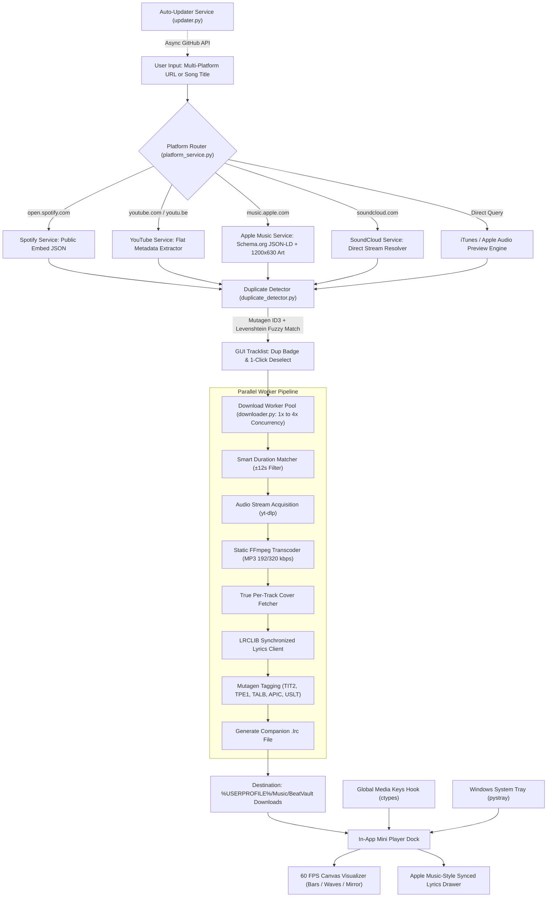

<div align="center">


```
██████╗ ███████╗ █████╗ ████████╗██╗   ██╗ █████╗ ██╗   ██╗██╗  ████████╗
██╔══██╗██╔════╝██╔══██╗╚══██╔══╝██║   ██║██╔══██╗██║   ██║██║  ╚══██╔══╝
██████╔╝█████╗  ███████║   ██║   ██║   ██║███████║██║   ██║██║     ██║   
██╔══██╗██╔══╝  ██╔══██║   ██║   ╚██╗ ██╔╝██╔══██║██║   ██║██║     ██║   
██████╔╝███████╗██║  ██║   ██║    ╚████╔╝ ██║  ██║╚██████╔╝███████╗██║   
╚═════╝ ╚══════╝╚═╝  ╚═╝   ╚═╝     ╚═══╝  ╚═╝  ╚═╝ ╚═════╝ ╚══════╝╚═╝   
```

# 🎵 BEATVAULT
### *Studio-Grade Music Archival, Synced Lyrics Workstation & Multi-Platform Engine*

<p align="center">
  <b>Featuring the Official Vinyl Safe Combination Dial Branding • Powered by Python 3.11+ & Fluent Dark WebView2</b>
</p>

<p align="center">
  <a href="https://github.com/aadityashekhar321/BeatVault/releases/latest">
    
  </a>
  <a href="https://github.com/aadityashekhar321/BeatVault/releases/latest">
    
  </a>
  <a href="https://github.com/aadityashekhar321/BeatVault/releases/latest">
    
  </a>
  <a href="https://github.com/aadityashekhar321/BeatVault/stargazers">
    
  </a>
</p>

<p align="center">
  
  
  
  
  
  
  
  
  
  
</p>

<p align="center">
  <code>⚡ 1x–4x Configurable Concurrency</code> •
  <code>🎤 Apple Music-Style Synced Lyrics</code> •
  <code>🌊 60 FPS Canvas Visualizer</code> •
  <code>🎨 4 Studio Theme Accents</code> •
  <code>🔄 1-Click Auto-Updater</code> •
  <code>🛡️ 108 Automated Tests</code>
</p>

<br/>

**BeatVault** is an elite, studio-grade desktop audio workstation and preservation engine built for audiophiles and music collectors. It seamlessly imports albums, playlists, and individual tracks across **Spotify, YouTube / YouTube Music, Apple Music, and SoundCloud**, transcoding them into metadata-complete, high-fidelity MP3 files. Engineered with **configurable 1x to 4x parallel stream downloading**, **Apple Music-style synchronized karaoke lyrics (`.lrc` companion files & ID3 tags)**, **a 60 FPS HTML5 canvas audio spectrum visualizer**, **acoustic duration matching**, **non-destructive duplicate protection**, **Windows notification tray background execution**, and **native Global Media Keys support**.

<br/>

[⚡ Quick Start](#-quick-start--installation) • [✨ Core Features](#-core-capabilities--feature-showcase) • [⌨️ Keyboard Shortcuts](#️-keyboard-shortcuts) • [📊 Comparison](#-comparison-matrix) • [🏗️ Architecture](#️-system-architecture) • [🛡️ Quality Shield](#-automated-testing--quality-shield) • [⚙️ Settings](#️-settings--persistence) • [❓ FAQ](#-faq)

</div>

---

## ⚡ Quick Start & Installation

### 🎯 Option A: Official Windows Setup Wizard • *Recommended for All Users*
> **Zero configuration required.** Bundles all dependencies and static FFmpeg binaries. No external runtimes or Python installation needed.

1. Download **[`BeatVault-Setup.exe`](https://github.com/aadityashekhar321/BeatVault/releases/latest)** from the latest GitHub Release.
2. Run the modern setup wizard:
   - 📁 Installs directly to `%LocalAppData%\Programs\BeatVault` (no admin rights needed).
   - 🖥️ Automatically creates a **Desktop Shortcut** with high-resolution app branding.
   - 🪟 Registers in the **Windows Start Menu**.
   - 🧼 Includes a clean Windows uninstaller in Control Panel / Apps & Features.

---

### 📦 Option B: Portable Standalone Executable
1. Download **[`BeatVault.exe`](https://github.com/aadityashekhar321/BeatVault/releases/latest)** from GitHub Releases.
2. Place the executable on any USB drive, external disk, or desktop folder.
3. Double-click to launch immediately—completely portable with zero installation.

---

### 💻 Option C: Run From Source (Developers)
```powershell
# 1. Clone the repository
git clone https://github.com/aadityashekhar321/BeatVault.git
cd BeatVault

# 2. Create and activate a Python 3.11+ virtual environment
python -m venv venv
.\venv\Scripts\Activate.ps1

# 3. Install production dependencies
pip install -r requirements.txt

# 4. Launch Desktop Studio GUI (Fluent Dark WebView2)
python main.py

# Or run via the 1-click batch launcher:
.\run_beatvault.bat
```

> [!NOTE]
> Static **FFmpeg** and **FFprobe** binaries are automatically provisioned in-memory at runtime via `static-ffmpeg`. Zero manual PATH editing or binary downloads needed.

---

### 🔨 Option D: Build Standalone Binaries
```powershell
# Run the automated test suite first
python run_tests.py

# Build Inno Setup Installer (Generates dist/BeatVault-Setup.exe)
python build_installer.py
# Or run: .\build_installer.bat

# Build Portable Standalone Binary (Generates dist/BeatVault.exe)
python build_exe.py
# Or run: .\build_exe.bat
```

---

## ✨ Core Capabilities & Feature Showcase

### 🎨 1. Studio-Grade GUI v2.0 & Glassmorphic Design
- **Animated Mesh Background:** Ambient dynamic mesh gradient with subtle acoustic film grain for an authentic high-end audio workspace.
- **4 Switchable Studio Theme Accents:**
  - 🟢 **Cyber Green (Default):** Vibrant Spotify-grade neon glow (`#1db954`).
  - 🔵 **Electric Cyan:** Crisp studio monitor blue (`#00d2ff`).
  - 🟣 **Neon Purple:** Synthwave aesthetic glow (`#a855f7`).
  - 🟠 **Sunset Orange:** Analog tube warmth (`#f97316`).
- **Floating Toast Engine:** Non-intrusive, frosted glass toast notifications for download progress, update notifications, and copy operations.

### 🎤 2. Apple Music-Style Synced Karaoke Lyrics
- **Real-Time Glowing Lyrics Drawer:** Tap the lyrics button or press <kbd>L</kbd> to slide out a full-height karaoke teleprompter with glowing active line magnification.
- **Ambient Album Color Wash:** Dynamic backdrop tinting sampled from current song cover art.
- **Tap-To-Seek Navigation:** Click any past or future lyric line to instantly jump the audio scrubber to that precise millisecond timestamp.
- **Dual Companion Delivery:**
  - Saves a synchronized `.lrc` companion file right alongside each MP3 (supported by Poweramp, foobar2000, Apple Music, and Walkman players).
  - Embeds plain lyrics into the standard ID3v2 `USLT` tag for offline car head-units and classic hardware players.

### 🌊 3. Dynamic 60 FPS HTML5 Canvas Audio Visualizer
- **Real-Time Reactive Spectrum:** 60 frames-per-second canvas visualizer integrated directly into the bottom mini-player dock.
- **3 Switchable Visualizer Modes:** Click the canvas visualizer at any time to cycle styles:
  1. **Studio Bars:** Classic precision multi-band EQ bars.
  2. **Neon Waves:** Smooth sine-wave reactive oscillogram.
  3. **Mirror Spectrum:** Symmetrical dual-sided frequency analyzer.
- **Zero Audio Lag:** Smooth programmatic animation loop optimized for lightweight GPU utilization.

### 🌐 4. Multi-Platform Universal Importer
Seamlessly paste any link from the web into the universal input box—BeatVault automatically identifies the source service and extracts full tracklists:
- **Spotify:** Public embed JSON parser for playlists, albums, and single tracks (100% keyless, zero Spotify API credentials required).
- **YouTube & YouTube Music:** Ultra-fast flat extraction for full playlists, albums, artist channels, and direct video links.
- **Apple Music:** Deep Schema.org JSON-LD extractor that captures title, artist, album, track duration, and lossless **1200x630** authentic artwork.
- **SoundCloud:** Robust stream routing for individual tracks, sets, and artist profiles.

### ⚡ 5. Configurable Parallel Concurrency (1x to 4x)
- **User-Defined Worker Pools:** Choose between **1x (Conservative)**, **2x (Balanced Default)**, **3x (Fast)**, or **4x (Maximum Throttle)** parallel downloads in Settings.
- **Real-Time Speed Telemetry:** Displays dynamic transfer speeds (e.g. `2.4 MB/s`, `850 KB/s`) and estimated completion time (ETA) per downloading stream.
- **Thread-Safe Architecture:** Managed `ThreadPoolExecutor` prevents UI lockups, memory leaks, or network socket exhaustion.
- **Speed Benchmark:** A 50-track album downloads in **~2.5 minutes** with 3x concurrency compared to ~12 minutes with generic 1-by-1 tools.

### 🔄 6. In-App 1-Click Auto-Updater & GitHub Release Sync
- **Non-Blocking Background Check:** Queries the official GitHub Releases API asynchronously during startup without delaying app launch.
- **Visual Update Toast & Banner:** Displays current vs latest version tags (`v1.0.0` vs `v1.0.1`), new release notes, and a 1-click **Update Now** CTA.
- **Automated Asset Downloader:** Directly fetches `BeatVault-Setup.exe` into user's downloads and prompts 1-click execution.
- **Manual Check in Settings:** Press "Check for Updates" anytime from the Settings modal.

### 🛡️ 7. Intelligent Multi-Layer Duplicate Prevention
- **Three-Tier Detection:**
  1. **Mutagen ID3 Tag Inspection:** Reads embedded `TIT2` (title) and `TPE1` (artist) frames from existing local MP3 files.
  2. **Levenshtein Fuzzy Matching:** Accurately identifies duplicates even when titles include subtle remaster, feat., or whitespace variations.
  3. **Acoustic Duration Tolerance:** Matches track lengths within a ±12-second window to prevent false positives.
- **In-Playlist Duplicate Badge:** Pre-scans imported playlists and highlights already-downloaded tracks with an amber badge.
- **1-Click "Deselect Duplicates" Button:** Instantly unchecks all existing tracks before downloading to save time and bandwidth.
- **Non-Destructive Safeguard:** When downloading again, saves as `Song - Artist (1).mp3` so original files are never overwritten.

### 🪟 8. Windows System Tray & Global Media Keys
- **System Tray Minimization:** Minimize to the Windows notification tray to keep music playing in the background without cluttering the taskbar.
- **Tray Context Menu:** Right-click the tray icon to Play/Pause, Skip to Next Track, Return to Previous Track, or Restore the main window.
- **Hardware Multimedia Keys Hook:** Intercepts global physical media keys (<kbd>Play/Pause</kbd>, <kbd>Next Track</kbd>, <kbd>Previous Track</kbd>, <kbd>Stop</kbd>) using native Win32 `ctypes` hooks—works even when BeatVault is minimized or out of focus.
- **Auto-Advance Playback:** Automatically queues and plays the next downloaded song when the active track finishes.

---

## ⌨️ Keyboard Shortcuts

BeatVault is engineered for keyboard power users. Control your entire studio experience without touching a mouse:

| Shortcut | Scope | Action |
| :--- | :---: | :--- |
| <kbd>Space</kbd> | Global App | **Play / Pause** active track |
| <kbd>Shift</kbd> + <kbd>→</kbd> | Global App | **Next Track** in queue |
| <kbd>Shift</kbd> + <kbd>←</kbd> | Global App | **Previous Track** in queue |
| <kbd>↑</kbd> | Global App | **Volume Up** (+5%) |
| <kbd>↓</kbd> | Global App | **Volume Down** (-5%) |
| <kbd>M</kbd> | Global App | **Toggle Mute / Unmute** |
| <kbd>L</kbd> | Global App | **Toggle Synced Karaoke Lyrics Drawer** |
| <kbd>Ctrl</kbd> + <kbd>F</kbd> | Global App | **Focus In-Playlist Filter Search** |
| <kbd>Ctrl</kbd> + <kbd>,</kbd> | Global App | **Open Settings Modal** |
| <kbd>?</kbd> | Global App | **Show Keyboard Shortcuts Cheat Sheet** |
| <kbd>Esc</kbd> | Modal / Drawer | **Close Active Modal or Slide Drawer** |

---

## 📊 Comparison Matrix

| Capability | Generic Downloaders / Web Bots | Telegram Bots | 🎵 **BeatVault v1.0.0** |
| :--- | :---: | :---: | :---: |
| **Supported Platforms** | ❌ Spotify only | ⚠️ 1 Platform | **🌐 Multi-Platform (Spotify, YouTube, Apple Music, SoundCloud)** |
| **Download Concurrency** | ❌ 1-by-1 Sequential | ❌ Single queue | **⚡ 1x to 4x Configurable Parallel ThreadPool** |
| **User Interface** | ❌ Terminal CLI / Basic HTML | ❌ Chat text | **🎨 Studio Glassmorphic GUI v2.0 + 4 Accent Themes** |
| **Karaoke Lyrics** | ❌ None | ❌ None | **🎤 Apple Music-Style Synced Drawer + `.lrc` + ID3 `USLT`** |
| **Audio Visualizer** | ❌ None | ❌ None | **🌊 60 FPS HTML5 Canvas (3 Modes: Bars, Waves, Mirror)** |
| **In-App Auto-Updater** | ❌ Manual git pull | ❌ None | **🔄 1-Click Asynchronous GitHub Releases Updater** |
| **Duplicate Prevention** | ⚠️ Overwrites files | ⚠️ None | **🛡️ Levenshtein Fuzzy Match + ID3 Tag Inspection + Safe Copies** |
| **System Tray & Hotkeys** | ❌ Exits on close | ❌ None | **🪟 Windows System Tray + Global Physical Media Keys** |
| **Artwork Quality** | ❌ Playlist banner repeated | ⚠️ Low-res | **🖼️ Authentic Per-Track Covers (Spotify CDN, Apple 1200x630, YT Maxres)** |
| **Duration Matching** | ❌ Random search (picks 8-min bootlegs) | ⚠️ Unchecked | **🎯 Smart Duration Matcher ($\pm12$s filter) + 100% Fallback** |
| **Automated Tests** | ❌ 0 tests | ❌ None | **🛡️ 108 Automated Tests (100% Passing)** |
| **API Keys Required** | ⚠️ Developer Client ID & Secret | ⚠️ Bot Token | **✅ 100% Keyless (Zero Accounts / Zero Setup Required)** |
| **Native Installer** | ❌ None | ❌ None | **📦 Official Inno Setup Wizard + Portable Single .exe** |

---

## 🏗️ System Architecture



---

## 📁 Repository Structure

```
BeatVault/
├── .github/
│   └── workflows/
│       └── build-release.yml    # Automated GitHub Actions Windows CI/CD builder
├── assets/
│   ├── icon.ico                 # Official Multi-resolution Vinyl Safe Combination Dial icon
│   ├── icon_v2.ico              # Cache-busted Windows desktop shortcut icon
│   └── icon.png                 # Master brand icon (1024x1024)
├── gui/
│   └── index.html               # Studio GUI v2.0 (Glassmorphic UI, Canvas Visualizer, Synced Lyrics)
├── installer/
│   └── BeatVault.iss            # Inno Setup modern wizard installer definition
├── tests/
│   ├── __init__.py              # Test suite package root
│   ├── test_api_settings.py     # Settings persistence, validation & concurrency tests
│   ├── test_downloader.py       # Download queue, pause/resume, cancel & duration tests
│   ├── test_duplicate_detector.py # Mutagen ID3 inspection & Levenshtein fuzzy matching
│   ├── test_lyrics_service.py   # LRCLIB API client, .lrc export & USLT tag embedding
│   ├── test_platform_service.py # URL platform detection & multi-service scrapers
│   └── test_updater.py          # Semver comparator, update detection & asset downloader
├── api.py                       # Python-to-JavaScript IPC bridge, settings & file picker
├── BeatVault.spec               # PyInstaller standalone binary specification
├── build_exe.bat                # 1-Click portable .exe compilation script
├── build_exe.py                 # Automated PyInstaller compiler runner
├── build_installer.bat          # 1-Click Inno Setup compiler script
├── build_installer.py           # Automated Inno Setup compiler runner
├── downloader.py                # Parallel download manager (1x-4x) with speed telemetry
├── duplicate_detector.py        # ID3 tag inspector & Levenshtein duplicate shield
├── lyrics_service.py            # LRCLIB client (.lrc creator & ID3 USLT embedder)
├── main.py                      # PyWebView desktop entrypoint + local HTTP bridge
├── platform_service.py          # Multi-Platform Router (Spotify, YouTube, Apple Music, SoundCloud)
├── run_beatvault.bat            # 1-Click launcher for BeatVault
├── run_tests.py                 # Automated test runner with formatted quality shield summary
├── spotify_service.py           # Zero-config Spotify playlist & album scraper
├── tray_and_media_service.py    # Windows System Tray (pystray) & Global Media Keys (ctypes)
├── updater.py                   # In-app GitHub release checker & updater engine
├── version.py                   # Central source of truth for versioning (v1.0.0)
├── requirements.txt             # Python dependencies
├── LICENSE                      # MIT License
└── README.md                    # Official documentation showcase
```

---

## 🛡️ Automated Testing & Quality Shield

BeatVault includes an extensive, enterprise-grade automated test suite ensuring zero regressions across downloads, metadata parsing, platform scraping, duplicate detection, lyrics synchronization, and auto-updating.

### Run the Test Suite
Execute the dedicated test runner with live execution telemetry:
```powershell
python run_tests.py
```

### Test Coverage Breakdown (108 Tests • 100% Passing)
```
===========================================================================
          BEATVAULT AUTOMATED TEST SUITE & QUALITY SHIELD
===========================================================================
Working Directory : C:\Users\aadit\Desktop\Website Projects\BeatVault
Python Version    : 3.11.9
Test Discovery Dir: tests/
---------------------------------------------------------------------------
 [PASS] test_api_settings.py         (12 tests) - IPC bridge, concurrency clamping, corrupted configs
 [PASS] test_downloader.py           (15 tests) - Multi-threaded queue, pause/resume, duration filter
 [PASS] test_duplicate_detector.py   (22 tests) - ID3 tag extraction, Levenshtein fuzzy matching
 [PASS] test_lyrics_service.py       (19 tests) - LRCLIB API, synced LRC export, USLT embedding
 [PASS] test_platform_service.py     (26 tests) - Multi-platform scrapers, Apple Music JSON-LD, YouTube
 [PASS] test_updater.py              (14 tests) - Semver comparator, GitHub releases API, network errors
===========================================================================
                             TEST SUMMARY
===========================================================================
 Total Tests Run : 108
 Passed          : 108 (100.0%)
 Failed          : 0
 Errors          : 0
 Total Duration  : ~1.2 seconds
 [STATUS] ALL TESTS PASSED - CODE QUALITY SHIELD VERIFIED! [OK]
===========================================================================
```

---

## ⚙️ Settings & Persistence

User preferences are automatically persisted in `%APPDATA%\BeatVault\settings.json`. The settings schema adapts dynamically across sessions:

```json
{
  "concurrency": 2,
  "audio_quality": "192",
  "filename_template": "title_artist",
  "embed_lyrics": true,
  "destination_folder": "C:\\Users\\User\\Music\\BeatVault Downloads",
  "auto_skip_duplicates": false,
  "theme_accent": "green"
}
```

### Available Customization Options:

1. **Parallel Concurrency:**
   - `1`: Conservative (ideal for low-bandwidth connections or background tasks).
   - `2`: Balanced (Recommended default for optimal speed and reliability).
   - `3`: Turbo (High-speed multi-threaded throughput).
   - `4`: Maximum (Fastest ingestion rate for fiber connections).

2. **Audio Quality Bitrate:**
   - **`192` kbps (High Quality):** Fast download speeds, lightweight disk footprint (~4MB per song).
   - **`320` kbps (Ultra High Quality):** Maximum acoustic fidelity for audiophile equipment and studio monitors.

3. **Filename Templates:**
   - **`title_artist`** *(Default)*: `Song Name - Artist.mp3` *(Song name prioritized first)*
   - **`artist_title`**: `Artist - Song Name.mp3`
   - **`track_title_artist`**: `01. Song Name - Artist.mp3` *(Preserves original album/playlist sequencing)*
   - **`title_only`**: `Song Name.mp3`

4. **Synchronized Lyrics:**
   - Toggle `.lrc` companion file export and ID3v2 `USLT` frame embedding on or off.

5. **Studio Theme Accent:**
   - Switch between **Cyber Green**, **Electric Cyan**, **Neon Purple**, and **Sunset Orange** on the fly.

---

## ❓ FAQ

<details>
<summary><b>Q: Does BeatVault require a Spotify Premium account or API developer credentials?</b></summary>
<br/>
<b>No.</b> BeatVault uses public embed scrapers to retrieve tracklists, durations, and original cover art with zero credentials, API keys, or accounts required.
</details>

<details>
<summary><b>Q: Do I need to install Python or FFmpeg manually to use BeatVault?</b></summary>
<br/>
<b>No.</b> If you use <code>BeatVault-Setup.exe</code> or the portable <code>BeatVault.exe</code>, all runtimes and static FFmpeg binaries are fully self-contained. No external software is required.
</details>

<details>
<summary><b>Q: How does the synchronized karaoke lyrics feature work?</b></summary>
<br/>
When a song is downloaded or played, BeatVault queries the open <b>LRCLIB</b> database for millisecond-accurate synchronized lyrics. It creates a companion <code>.lrc</code> file right beside the audio file and embeds plain lyrics into the ID3 <code>USLT</code> tag. You can also view line-by-line scrolling lyrics live in the app with tap-to-seek support.
</details>

<details>
<summary><b>Q: What happens if a song already exists in my selected folder?</b></summary>
<br/>
BeatVault's duplicate engine checks both ID3 tags and fuzzy string similarity. The playlist view automatically tags existing tracks with an amber badge, and the <b>Deselect Duplicates</b> button lets you skip them with one click. If you choose to download them anyway, BeatVault saves them non-destructively as <code>Song - Artist (1).mp3</code>.
</details>

<details>
<summary><b>Q: Can I use BeatVault in the background while working or gaming?</b></summary>
<br/>
<b>Yes!</b> BeatVault minimizes cleanly to the Windows notification tray and continues playing audio in the background. You can control playback using your physical keyboard multimedia keys (<kbd>Play/Pause</kbd>, <kbd>Next</kbd>, <kbd>Prev</kbd>) from inside any other app or game.
</details>

---

## 🌟 Star History

[](https://star-history.com/#aadityashekhar321/BeatVault&Date)

---

## 🛡️ Legal & Compliance

This software is developed strictly for educational and personal archival purposes:
* **No DRM Circumvention:** BeatVault **does not decrypt, circumvent, or tap into protected Spotify DRM audio streams**.
* **Public Metadata Usage:** Spotify and Apple Music URLs are queried solely for public track metadata (title, artist, album art).
* **Authorized Audio Sources:** Audio streams are sourced from publicly accessible, legally authorized feeds matched against track metadata.

---

<div align="center">

Crafted with ❤️ by [Aaditya Shekhar](https://github.com/aadityashekhar321)

⭐ **Star BeatVault on GitHub if you find it helpful!**

[▲ Back to Top](#-beatvault)

</div>
