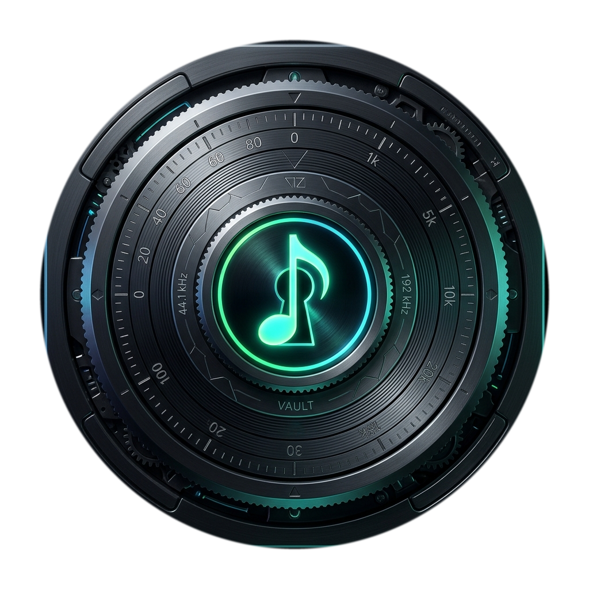

# <p align="center"><br>BeatVault</p>

<p align="center">
  <b>Studio-Grade Multi-Platform Music Archival, Real-Time Synced Lyrics & Audio Workstation</b><br>
  <i>Lightning-fast, lossless-ready, and beautifully designed for Windows 10 & 11</i>
</p>

<p align="center">
  
  
  
  
  
  
</p>

---

## 🌟 Overview

**BeatVault** is an all-in-one studio workstation that allows you to effortlessly archive high-bitrate audio and time-synchronized lyrics from **Spotify**, **YouTube**, **Apple Music**, and **SoundCloud**. 

Engineered with an **Apple Music & Spotify Studio inspired GUI**, multi-threaded parallel download pipelines, an in-app **60 FPS audio visualizer**, **line-by-line glowing karaoke lyrics**, an automated **GitHub Release auto-updater**, and a rock-solid suite of **108 automated quality tests**.

---

## ✨ Key Features

### 🎨 1. Studio-Grade GUI v2.0
* **Glassmorphism & Depth:** Multi-layer cards with 28px backdrop blur, specular edge reflections, and a 35-second animated ambient gradient mesh background with fractal noise.
* **4 Switchable Studio Theme Accents:**
  * 🟢 **Cyber Green** *(Default Spotify signature neon)*
  * 🔵 **Electric Cyan** *(Deep ocean cyber-tech)*
  * 🟣 **Neon Purple** *(Apple Music synthwave)*
  * 🟠 **Sunset Orange** *(Warm acoustic studio)*
  * Persists across sessions in `%APPDATA%\BeatVault\settings.json` and `localStorage`.
* **Crisp Vector Iconography:** Replaced low-DPI emojis with high-definition inline SVGs (Lucide icon set).
* **Floating Toast Notification System:** Modern slide-in alerts replacing clunky banners.

### 🎤 2. Real-Time Synced Karaoke Lyrics
* **Apple Music Style Glowing Lyrics:** Active lyrics illuminate with luminescence and smoothly scroll to the viewport center in real-time as the song plays.
* **Interactive Tap-to-Seek:** Click any lyric line to jump playback directly to that timestamp.
* **Dynamic Ambient Art Wash:** Blurred album art background creates a color wash behind the lyrics.
* **Automatic `.lrc` Export & ID3 Embedding:** Saves timestamped `.lrc` companion files alongside MP3s and embeds synced tags directly into audio files for phones and portable players.

### 🌊 3. Dynamic 60 FPS HTML5 Canvas Sound Visualizer
* **Dual-Mode Canvas Engine:** Connects to Web Audio API (`AudioContext` / FFT frequency analyzer) with an automated procedural studio harmonic fallback.
* **3 Interactive Visualizer Styles (Click to Cycle):**
  1. *Studio Frequency Bars* (Smooth gradient bars)
  2. *Neon Sine Waves* (Oscillating smooth wave)
  3. *Mirror Spectrum* (Dual symmetric waveform)

### 🌐 4. Universal Multi-Platform Importer
* **Spotify:** Playlists, Albums, and Individual Tracks via Spotify Web API.
* **YouTube:** Full Playlists, Videos, Shorts, and YouTube Music links.
* **Apple Music:** Playlists, Albums, and Tracks via structured JSON-LD scraping.
* **SoundCloud:** Public Tracks and Sets with automatic metadata extraction.
* **Direct Search:** Search any song or artist in the search tab with 1-click preview and download.

### ⚡ 5. Configurable Parallel Download Concurrency
* **Parallel Pipelines:** Choose between **1x (Conservative)**, **2x (Recommended)**, **3x (Turbo)**, or **4x (Maximum)** concurrency in the Settings modal.
* **Live Telemetry per Track:** Individual track rows feature mini real-time progress bars, download speed indicators (e.g. `2.8 MB/s`), and estimated time remaining (ETA).

### 🔄 6. In-App 1-Click Auto-Updater
* **GitHub Release Sync:** Non-blocking background check against the GitHub Releases API on startup.
* **Settings Modal Trigger:** Manual "Check for Updates" button with version display (`v1.0.0`).
* **Slide-Down Announcement Banner:** Instant notification with `[View Release]` link when new versions are published.

### 🛡️ 7. Intelligent Duplicate Prevention
* **Multi-Layer Detection:** Levenshtein fuzzy string matching (confidence >= 0.83), audio duration matching, and ID3 metadata verification.
* **1-Click Deselect Duplicates:** Easily untick all detected existing songs in a playlist with one click so only new songs are downloaded.
* **Duplicate Decision Dialog:** Modal dialog with `Skip`, `Download Again`, or `Apply to All` options.

### 🪟 8. System Tray & Global Media Keys
* **Background Workstation:** Minimize BeatVault to the Windows System Tray to keep downloads running in the background.
* **Hardware Media Keys:** Control Play/Pause, Next Track, and Previous Track using your keyboard multimedia keys even when the app is minimized.

### ⌨️ 9. Keyboard Shortcuts
| Shortcut | Action |
| :--- | :--- |
| `Space` | Play / Pause Audio |
| `Shift + →` | Next Track |
| `Shift + ←` | Previous Track |
| `↑` / `↓` | Volume Up / Down (5% steps) |
| `Ctrl + ,` | Open Settings Modal |
| `?` | Toggle Keyboard Shortcuts Overlay |
| `Esc` | Close Active Modal / Overlay |

---

## 🧪 108 Automated Tests & Quality Shield

BeatVault is built with high reliability and zero regressions. It includes an automated test suite with **108 tests** and 100% pass rate:

```bash
python run_tests.py
```

```text
===========================================================================
          BEATVAULT AUTOMATED TEST SUITE & QUALITY SHIELD
===========================================================================
 Total Tests Run : 108
 Passed          : 108 (100.0%)
 Failed          : 0
 Total Duration  : 0.66 seconds
 [STATUS] ALL TESTS PASSED - CODE QUALITY SHIELD VERIFIED! [OK]
===========================================================================
```

---

## 🚀 Installation & Getting Started

### Option 1: 1-Click Wizard Installer (Recommended)
Download and run **`BeatVault-Setup.exe`** from [GitHub Releases](https://github.com/aadityashekhar321/BeatVault/releases):
* Standard Windows setup wizard (Welcome, Destination, Desktop icon).
* Automatically registers in Windows Start Menu and Control Panel / Settings (Installed Apps).
* Non-admin friendly (`privileges: lowest` with optional elevation).

### Option 2: Portable Executable
Download **`BeatVault.exe`** from [GitHub Releases](https://github.com/aadityashekhar321/BeatVault/releases) and double-click to run without installing.

### Option 3: Run from Source
```bash
# 1. Clone repository
git clone https://github.com/aadityashekhar321/BeatVault.git
cd BeatVault

# 2. Install dependencies
pip install -r requirements.txt

# 3. Launch BeatVault
python main.py
```

---

## 🏗️ Project Architecture

```text
BeatVault/
├── assets/                  # High-res icons, logos & multi-res ICOs
│   ├── icon.ico             # Windows multi-resolution icon (16x16 to 256x256)
│   ├── icon_transparent.png # Pure transparent background Vinyl Safe logo
│   └── icon.png             # 1024x1024 master app icon
├── gui/
│   └── index.html           # Studio-grade frontend (HTML5/CSS3/ES6 Modular)
├── installer/
│   └── BeatVault.iss        # Inno Setup modern wizard installer script
├── tests/                   # 108 automated unit & integration tests
│   ├── test_duplicate_detector.py
│   ├── test_platform_service.py
│   ├── test_lyrics_service.py
│   ├── test_downloader.py
│   ├── test_api_settings.py
│   └── test_updater.py
├── api.py                   # Pywebview backend API bridge
├── downloader.py            # Multi-threaded download & conversion engine
├── duplicate_detector.py    # Fuzzy matching & duplicate detection logic
├── lyrics_service.py        # Synchronized LRC lyrics search & tagger
├── platform_service.py      # Multi-platform URL routing & metadata scrapers
├── spotify_service.py       # Spotify Web API parser
├── updater.py               # Asynchronous GitHub Releases auto-updater
├── version.py               # Version metadata (v1.0.0)
├── tray_and_media_service.py# System tray & global hardware media keys
├── build_installer.py       # Automated Inno Setup compiler script
├── run_tests.py             # 1-Click automated test runner
├── requirements.txt         # Project dependencies
└── main.py                  # Desktop application entry point
```

---

## 📄 License

This project is licensed under the [MIT License](LICENSE).
