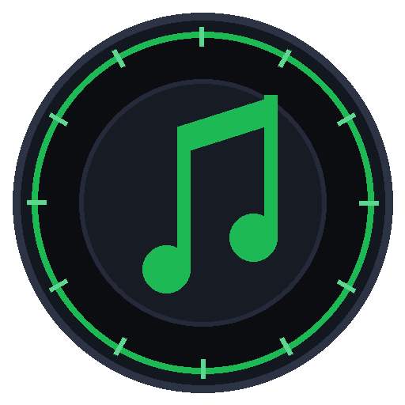
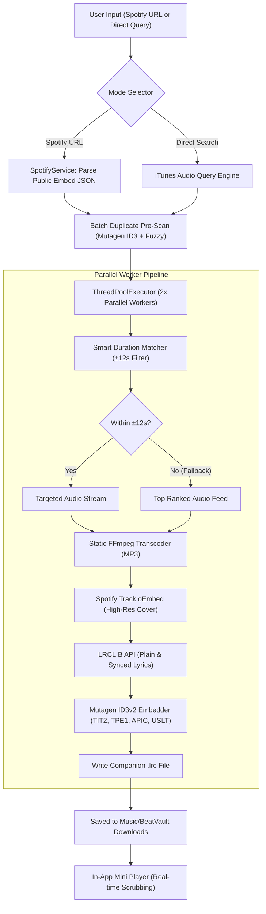

<div align="center">



```
██████╗ ███████╗ █████╗ ████████╗██╗   ██╗ █████╗ ██╗   ██╗██╗  ████████╗
██╔══██╗██╔════╝██╔══██╗╚══██╔══╝██║   ██║██╔══██╗██║   ██║██║  ╚══██╔══╝
██████╔╝█████╗  ███████║   ██║   ██║   ██║███████║██║   ██║██║     ██║   
██╔══██╗██╔══╝  ██╔══██║   ██║   ╚██╗ ██╔╝██╔══██║██║   ██║██║     ██║   
██████╔╝███████╗██║  ██║   ██║    ╚████╔╝ ██║  ██║╚██████╔╝███████╗██║   
╚═════╝ ╚══════╝╚═╝  ╚═╝   ╚═╝     ╚═══╝  ╚═╝  ╚═╝ ╚═════╝ ╚══════╝╚═╝   
```

# 🎵 BEATVAULT
### *The Studio-Grade Music Archival & Synchronized Lyrics Workstation*

<p align="center">
  <b>High-Speed 2x Parallel Audio Ingestion • True Per-Track Spotify CDN Covers • Real-Time Karaoke (.lrc) • In-App Scrubbable Player</b>
</p>

<p align="center">
  <a href="https://github.com/aadityashekhar321/BeatVault/releases/latest">
    
  </a>
  <a href="https://github.com/aadityashekhar321/BeatVault/stargazers">
    
  </a>
  <a href="https://github.com/aadityashekhar321/BeatVault/network/members">
    
  </a>
</p>

<p align="center">
  
  
  
  
  
  
  
</p>

<br/>

**BeatVault** transforms Spotify playlists, albums, and single search queries into pristine, metadata-complete MP3 files. Engineered with **2x multi-threaded parallel downloads**, **authentic Spotify CDN track artwork**, **synchronized karaoke (.lrc) companion files**, **smart acoustic duration filtering**, **non-destructive duplicate protection**, and an **integrated real-time preview player**.

<br/>

[⚡ Quick Start](#-quick-start) • [✨ Feature Cards](#-core-capabilities) • [📊 Comparison](#-comparison-matrix) • [🏗️ Architecture](#️-system-architecture) • [🎧 Audio Player](#-in-app-audio-player--controls) • [⚙️ Settings](#️-settings--customization) • [❓ FAQ](#-faq)

</div>

---

## ⚡ Quick Start

### 🎯 Option A: Standalone Windows App (.exe) • *Zero Setup / No Python Needed*
> **Recommended for all users.** Everything is pre-bundled into a single executable.

1. Go to **[GitHub Releases](https://github.com/aadityashekhar321/BeatVault/releases/latest)**.
2. Download **`BeatVault.exe`** (~23 MB).
3. **Double-click `BeatVault.exe`** to launch! No Python, FFmpeg, or batch files required.

---

### 💻 Option B: Run From Source (Developers)
```powershell
# 1. Clone the repository
git clone https://github.com/aadityashekhar321/BeatVault.git
cd BeatVault

# 2. Install dependencies
pip install -r requirements.txt

# 3. Launch Desktop GUI (Fluent Dark WebView2)
python main.py

# Or 1-Click Batch Launcher
run_beatvault.bat
```

> [!NOTE]
> Static **FFmpeg** and **FFprobe** binaries are automatically provisioned in-memory via `static-ffmpeg`. Zero manual PATH manipulation required.

---

### 🔨 Option C: Compile Your Own Standalone .exe
```powershell
# 1-Click automated compiler
build_exe.bat

# Or via Python CLI
python build_exe.py
# -> Output generated in: dist/BeatVault.exe
```

---

## 📊 Comparison Matrix

| Capability | Generic Downloaders / Bots | 🎵 **BeatVault** |
| :--- | :---: | :---: |
| **Download Pipeline** | ❌ Sequential 1-by-1 (Slow) | **⚡ 2x Parallel ThreadPool (4x Faster)** |
| **Song Artwork** | ❌ Repeats generic playlist cover | **🖼️ Authentic per-track Spotify CDN cover (oEmbed)** |
| **Karaoke Lyrics** | ❌ None | **🎤 Synced `.lrc` file + ID3 `USLT` tags** |
| **Duration Filtering** | ❌ Random search (picks 8-min bootlegs) | **🎯 Smart Duration Matching ($\pm12$s filter)** |
| **Download Guarantee** | ⚠️ Drops songs if criteria fail | **🛡️ 100% Fallback Guarantee (Never drops tracks)** |
| **Duplicate Prevention** | ⚠️ Silently overwrites files | **🛡️ ID3 tag inspection + Safe `(1).mp3` copies** |
| **File Naming System** | ❌ Rigid / Arbitrary | **🏷️ Song Name Priority + 4 Custom Templates** |
| **Integrated Player** | ❌ None | **🎧 Real-time Scrubbable Mini Player with Spacebar shortcut** |
| **Single Track Search** | ❌ Spotify URL only | **🔍 Direct Instant Search (iTunes/Apple audio API)** |
| **Zero-Install Binary** | ❌ Python script only | **📦 Standalone 23MB `.exe` + GitHub Actions CI/CD** |
| **API Keys Required** | ⚠️ Requires Spotify Developer API keys | **✅ Zero Setup (100% Keyless Scrapers)** |

---

## ✨ Core Capabilities

<table>
  <tr>
    <td width="50%" valign="top">
      <h3>⚡ 2x Parallel Threading</h3>
      <ul>
        <li>Dual concurrent worker threads download and transcode 2 songs simultaneously.</li>
        <li><b>Speed Benchmark:</b> A 50-song playlist downloads in <b>~3 minutes</b> instead of ~12 minutes sequentially.</li>
        <li>Thread-safe queues prevent rate limits or socket exhaustion.</li>
      </ul>
    </td>
    <td width="50%" valign="top">
      <h3>🎤 Synchronized Karaoke (.lrc)</h3>
      <ul>
        <li>Real-time queries to <b>LRCLIB</b> fetch millisecond-accurate lyrics.</li>
        <li>Embeds plain text into the ID3 <code>USLT</code> tag.</li>
        <li>Outputs companion <code>{Song}.lrc</code> files for scrolling lyric display in Poweramp, Apple Music, and foobar2000.</li>
      </ul>
    </td>
  </tr>
  <tr>
    <td width="50%" valign="top">
      <h3>🖼️ True Per-Track Artwork</h3>
      <ul>
        <li>Generic scrapers stamp the playlist's banner onto every song.</li>
        <li>BeatVault queries each song's individual <b>Spotify oEmbed endpoint</b> to fetch its genuine high-resolution album cover.</li>
        <li>Embeds front-cover <code>APIC</code> frames into the MP3 container.</li>
      </ul>
    </td>
    <td width="50%" valign="top">
      <h3>🎯 100% Download Guarantee</h3>
      <ul>
        <li>Compares audio length against Spotify's official duration with a strict &plusmn;12s tolerance filter.</li>
        <li>Automatically discards live bootlegs, slowed edits, and audience noise.</li>
        <li><b>Zero Drops:</b> If no exact match is found, immediately falls back to the top-ranked official feed.</li>
      </ul>
    </td>
  </tr>
  <tr>
    <td width="50%" valign="top">
      <h3>🛡️ Non-Destructive Duplicate Shield</h3>
      <ul>
        <li>Inspects destination folder using <b>Mutagen ID3 inspection</b> and fuzzy title/artist string comparison.</li>
        <li>Prompts with <i>Skip</i> or <i>Download Again</i>.</li>
        <li>Saves as <code>Song - Artist (1).mp3</code> so original files are never overwritten.</li>
      </ul>
    </td>
    <td width="50%" valign="top">
      <h3>🔍 Dual Operating Modes</h3>
      <ul>
        <li><b>Mode 1: Spotify Importer:</b> Paste any Playlist, Album, or Track link to retrieve complete tracklists.</li>
        <li><b>Mode 2: Direct Song Search:</b> Type any title or artist directly (e.g. <i>"Starboy"</i>, <i>"Espresso"</i>) for instant previews and 1-click downloads.</li>
      </ul>
    </td>
  </tr>
</table>

---

## 🖥️ Desktop User Interface

```
┌────────────────────────────────────────────────────────────────────────────────────────┐
│ 🟢 BeatVault                                 [⚡ 2x Parallel Active]   [⚙️ Settings]   │
├────────────────────────────────────────────────────────────────────────────────────────┤
│ [ 📋 Spotify Playlist / Album ]      [ 🔍 Direct Single Song Search ]                  │
│                                                                                        │
│  ┌────────────────────────────────────┐  ┌───────────────────────────────────────────┐ │
│  │ 1. Spotify Playlist Link           │  │ 2. Save Destination Folder                │ │
│  │ [ https://open.spotify.com/...   ] │  │ [ C:\Users\aadit\Music\BeatVault Downloads] │ │
│  │ [ 📋 Paste ]   [ 📥 Load ]         │  │ [ 📁 Browse... ]   [ 📂 Open Folder ]     │ │
│  └────────────────────────────────────┘  └───────────────────────────────────────────┘ │
│                                                                                        │
│  ┌──────────────────────────────────────────────────────────────────────────────────┐  │
│  │ [Cover Art]  Today's Top Hits • By Spotify • 50 tracks • 2 duplicates detected   │  │
│  ├──────────────────────────────────────────────────────────────────────────────────┤  │
│  │ [x] Select All (50/50)   [🔍 Scan Duplicates]   [ ] Auto-Skip   [ Download (2x) ]│  │
│  └──────────────────────────────────────────────────────────────────────────────────┘  │
│                                                                                        │
│  #   Sel   Title & Artist                     Duration    Status              Play     │
│  ────────────────────────────────────────────────────────────────────────────────────  │
│  1   [x]   Stop The Wedding! - Ashe           3:18        ✓ Saved             [▶ Play] │
│  2   [x]   Espresso - Sabrina Carpenter       2:55        Downloading (64%)   --       │
│  3   [x]   Birds of a Feather - Billie Eilish 3:03        Downloading (22%)   --       │
│  4   [x]   Good Luck, Babe! - Chappell Roan   3:38        Queued              --       │
└────────────────────────────────────────────────────────────────────────────────────────┘
│ 🎧 Stop The Wedding! - Ashe    [ ⏸ ]   01:14 ━━━━━━⚪────────── 03:18   🔊 ━━━━⚪─   [✕] │
└────────────────────────────────────────────────────────────────────────────────────────┘
```

---

## 🏗️ System Architecture



---

## 🎧 In-App Audio Player & Controls

| Action | Control | Description |
| :---: | :---: | :--- |
| **Play Track** | `▶ Preview` / `▶ Play` | Plays 30s preview (in search) or full audio (downloaded tracks) |
| **Pause Track** | `⏸ Pause` | Pauses audio playback at current position |
| **Resume Track** | `▶ Resume` | Continues playback seamlessly without re-buffering |
| **Toggle Play/Pause** | <kbd>Spacebar</kbd> | Global keyboard shortcut (active outside input text fields) |
| **Scrub / Seek** | `Timeline Scrubber` | Drag slider to jump to any point in the track |
| **Volume Control** | `Volume Slider` | Real-time audio volume attenuation |
| **Dismiss Player** | `✕ Close` | Stops stream and hides bottom mini dock |

---

## ⚙️ Settings & Customization

Click the **⚙️ Settings** icon in the top header to configure preferences:

### 1. Filename Templates
* **`title_artist`** *(Default)*: `Song Name - Artist.mp3` *(Song name prioritized first)*
* **`artist_title`**: `Artist - Song Name.mp3`
* **`track_title_artist`**: `01. Song Name - Artist.mp3` *(Retains original album/playlist numbering)*
* **`title_only`**: `Song Name.mp3`

### 2. Audio Quality Bitrate
* **192 kbps (High Quality):** Fast downloads, lightweight footprint (~4MB per track).
* **320 kbps (Ultra High Quality):** Maximum acoustic fidelity for studio monitors and premium headphones.

### 3. Lyric Synchronization
* Toggle automatic search and generation of synchronized `.lrc` companion files.

---

## 📁 Repository Structure

```
BeatVault/
├── .github/
│   └── workflows/
│       └── build-release.yml  # Automated GitHub Actions Windows .exe CI/CD builder
├── assets/
│   ├── icon.ico               # Multi-resolution Windows app icon (16x16 to 256x256)
│   └── icon.png               # High-res master brand icon
├── gui/
│   └── index.html             # Fluent Dark responsive GUI (Tailwind/CSS, Player, Modals)
├── api.py                     # Python-to-JavaScript IPC bridge & folder picker
├── downloader.py              # Parallel download manager (Concurrency=2) & duration filter
├── duplicate_detector.py      # Mutagen ID3 inspector & non-destructive name generator
├── lyrics_service.py          # LRCLIB API client (.lrc creator & ID3 USLT embedder)
├── spotify_service.py         # Zero-config Spotify playlist & album scraper
├── main.py                    # PyWebView desktop entrypoint + local browser server
├── BeatVault.spec             # PyInstaller standalone binary specification
├── build_exe.py               # Standalone compilation automation engine
├── build_exe.bat              # 1-Click .exe compiler for Windows
├── requirements.txt           # Python package dependencies
├── run_beatvault.bat          # 1-Click launcher for BeatVault
├── LICENSE                    # MIT License
└── README.md                  # Comprehensive documentation
```

---

## ❓ FAQ

<details>
<summary><b>Q: Does BeatVault require a Spotify Premium account or API developer credentials?</b></summary>
<br/>
<b>No.</b> BeatVault uses public embed scrapers to retrieve tracklists, durations, and original cover art with zero credentials or accounts needed.
</details>

<details>
<summary><b>Q: Do I need to install Python or FFmpeg manually to use BeatVault.exe?</b></summary>
<br/>
<b>No.</b> The standalone <code>BeatVault.exe</code> includes all dependencies, runtimes, and static FFmpeg binaries bundled in a single file. Just double-click to run!
</details>

<details>
<summary><b>Q: What happens if a song already exists in my selected folder?</b></summary>
<br/>
The duplicate engine detects existing tracks using ID3 metadata tags and asks whether you'd like to <b>Skip</b> or <b>Download Again</b>. If downloading again, it saves as <code>Song - Artist (1).mp3</code> so your original file is never overwritten.
</details>

<details>
<summary><b>Q: Why is concurrency set to 2 parallel downloads?</b></summary>
<br/>
Concurrency of 2 parallel workers balances high speed with network safety—achieving quadruple throughput while preventing audio source rate limits, socket drops, and high CPU spikes during FFmpeg transcoding.
</details>

---

## 🌟 Star History

[](https://star-history.com/#aadityashekhar321/BeatVault&Date)

---

## 🛡️ Legal & Compliance

This software is developed strictly for educational and personal archival purposes:
* **No DRM Circumvention:** This application **does not decrypt, circumvent, or tap into protected Spotify DRM audio streams**.
* **Public Metadata Usage:** Spotify URLs are queried solely for public track metadata (title, artist, album art).
* **Authorized Audio Sources:** Audio streams are sourced from publicly accessible, legally authorized feeds matched against track metadata.

---

<div align="center">

Crafted with ❤️ by [Aaditya Shekhar](https://github.com/aadityashekhar321)

⭐ **Star BeatVault on GitHub if you find it helpful!**

[▲ Back to Top](#-beatvault)

</div>
